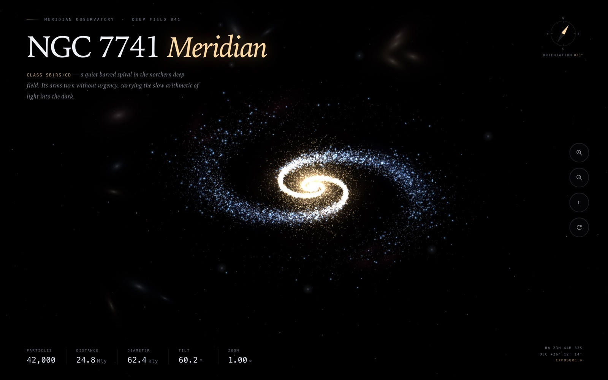

# NGC 7741 Meridian

**A quiet observatory instrument, rendered in a single HTML file.**

[**Open the live instrument →**](https://zidansilverlane-boop.github.io/ngc-7741-meridian/)



A full-viewport Canvas 2D spiral galaxy built from 42,000 additive particles, presented as a planetarium display at midnight. Tilt it, zoom it, pause it, and let the differential rotation wind the arms while the field holds still.

## The instrument

- **42,000 particles** by default — a Gaussian spherical bulge (18%) and two logarithmic spiral arms following `r = a·e^(bθ)` with `b = 0.28`.
- **Differential rotation** with `ω = 0.35 / (0.25 + r)`: the core visibly outruns the rim, so the spiral winds over time.
- **Radius-mapped light** — warm white and gold in the core (`#FFEBBE` → `#FFCD82`), blue-white along the arms (`#CDD7FF` → `#91C3FF`), faint red-magenta dust at the rim (`#AA7882` → `#D25058`).
- **Additive glow** from a cached set of pre-rendered 32 px sprites, plus 90 soft nebula ellipses, a warm core glow, a faint starfield, and twelve blurred background galaxies baked to an offscreen canvas.
- **Observatory HUD** — serif designation with an amber *Meridian*, an italic classification, live tabular telemetry, a yaw compass, and four glass controls.
- **Dignified reduced motion** — `prefers-reduced-motion` drops the field to 14,000 particles and starts paused; press play to resume.

## Controls

| Input | Action |
| --- | --- |
| Drag | Yaw (horizontal) and tilt (vertical) |
| Mouse wheel / two-finger pinch | Zoom, 0.35×–6× |
| <kbd>Space</kbd> | Pause / resume rotation |
| Arrow keys | Yaw and tilt (keyboard) |
| <kbd>+</kbd> / <kbd>−</kbd> | Zoom in / out |
| <kbd>R</kbd> | Reset to the default oblique view |
| Zoom / pause / reset buttons | Same, right edge |

The buttons have accessible labels; the canvas is focusable and described for keyboard users.

## Run locally

There is no build step and no dependencies.

```bash
git clone https://github.com/zidansilverlane-boop/ngc-7741-meridian.git
cd ngc-7741-meridian
open index.html          # macOS
# or: python3 -m http.server 8080
```

Everything is in [`index.html`](index.html): markup, CSS, SVG icons and compass, particle generation, rendering and interaction.

## Implementation notes

- Vanilla JavaScript and Canvas 2D. No frameworks, fonts, analytics or network requests.
- The canvas backing store follows `devicePixelRatio` capped at 2, resizes cleanly, and avoids redrawing static paused frames.
- The galaxy is deterministic, generated once from seeded scatter; live `prefers-reduced-motion` changes rebuild the field at the alternate density.
- The 42,000 additive sprites are the dominant frame cost; pausing stops the render loop's canvas work entirely.

## License

[MIT](LICENSE) © 2026 Zidan Silverlane.
